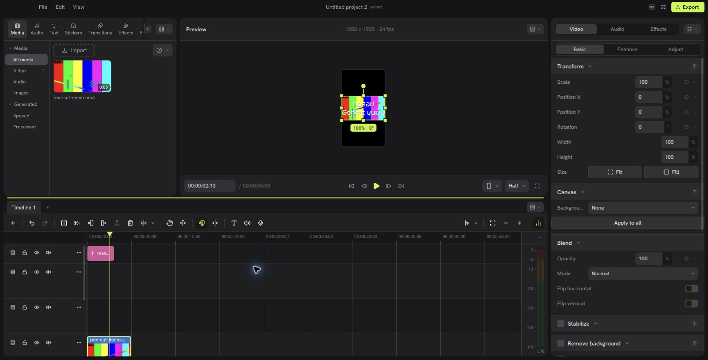
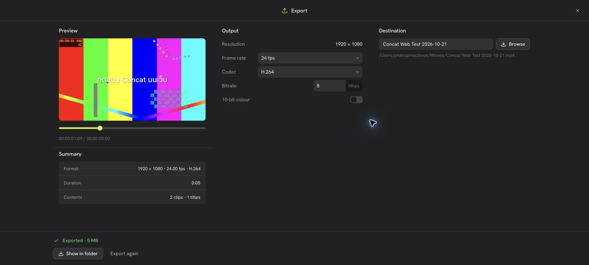

# Concat original UI — local browser port

This branch replaces the earlier separately written HTML editor approach.
The browser compiles `src/crates/concat/ui/app.slint` with Slint's WebAssembly
backend. Every panel, dialog, layout, icon and style is the upstream component
itself. There is no remote desktop or application screenshot transport.

The native process keeps the original Rust `Studio`, callback registrations,
project operations, media engine and undo history. `web/bridge/generate.py`
generates typed transport for the public Slint state and actions. Browser UI
callbacks invoke the existing native callbacks; state changes return to the
browser's own components. Native frame/thumbnail images are media assets,
not pictures of the application interface.

Pure formatting, Bézier curves, keyboard parsing, text insertion and translation
reuse the original Rust helpers. Model updates preserve row identity so a native
state update does not destroy an active browser pointer gesture.

## Build

- Browser: `cd web/wasm && cargo build --release --target wasm32-unknown-unknown`,
  then run the matching `wasm-bindgen --target web --out-dir pkg` on
  `target/wasm32-unknown-unknown/release/concat_browser.wasm`.
- Native: install the dependencies in `src/README.md`, then
  `cd src && cargo build -p concat --profile quick --features web-bridge`.
- CI: `Original UI WebAssembly` and `Original UI native host` on this branch
  produce downloadable artifacts. This avoids large local Rust build directories.

## Run

Place browser artifacts in `web/wasm/pkg/` and the native host in
`vendor/browser-host/concat`, with its libraries in `vendor/browser-host/lib/`.
Keep an empty `vendor/browser-host/portable/` directory to isolate settings and
recents from the installed desktop app. Then:

```sh
node web/original/server.mjs
```

Open `http://127.0.0.1:4317`. `CONCAT_WEB_BINARY`, `CONCAT_WEB_DATA` and `PORT`
configure the host binary, import storage and local port. Imported files are
copied into `web/original-data/imports/`; original files are untouched.

The server binds only to loopback and refuses cross-origin requests. It is
intended for one person on this Mac, not public hosting or multiple independent
editing sessions. Tabs share the native application session.

## Validation

Verified on macOS Apple M1 with Chrome, 21–22 October 2026:

- Original start screen, project creation and four default tracks.
- Opening an existing original `concat.json` project.
- Browser file picker → local import → original media bin and thumbnail.
- Media selection/activation and the original preview.
- `Cmd+B` splits a five-second clip into two 2.5-second clips; `Cmd+Z` restores it.
- Original title preset and editing Thai title text.
- H.264/AAC export: 1920×1080, 24 fps, five seconds. The exported file fully
  decodes with FFmpeg and its Thai text was visually checked.
- Native CI smoke exercises create/title/undo through the generated callbacks.

The final WASM event-loop wakeup fix (run `39556526595`) was visually
revalidated in Chrome on 22 October: one Play click advances the five-second
clip to its end without further pointer input, and the timecode, playhead and
preview update. Split and undo were rechecked on this installed build.
This verifies updates without user input, not a sustained frame-rate benchmark.

Run the native smoke check with:

```sh
node web/original/smoke.mjs /absolute/path/to/bridge-enabled/concat
```





## Current limits

This is an initial local port; advanced desktop features have not all been
validated. Preview frames travel as media images over loopback, so playback
performance can differ from the desktop GPU renderer. Audio processing and
device playback run on this Mac through the original engine. Remote browser
audio and browser microphone capture are not implemented. Desktop self-update
is blocked here because it would replace the bridge-enabled engine.

Project/output folder dialogs accept paths on this Mac; media selection uses
a browser file picker and uploads to the local host. Browser folder drops and
native drag preview chips are not implemented. Native keyboard/menu shortcuts
that conflict with browser shortcuts may require using the visible menu.

Build artifacts are generated by the two workflows on `feat/original-ui-web`.
Install the `concat-original-ui-wasm` files in `web/wasm/pkg/` and extract
`concat-browser-host-macos-arm64.tar.gz` into `vendor/browser-host/`.

## Opening in Chrome

If a tab created by browser automation shows `ERR_BLOCKED_BY_CLIENT`, open a
normal Chrome tab with Cmd+T and enter `http://127.0.0.1:4317` directly. This
was sufficient on the tested machine; no browser protection was disabled.
